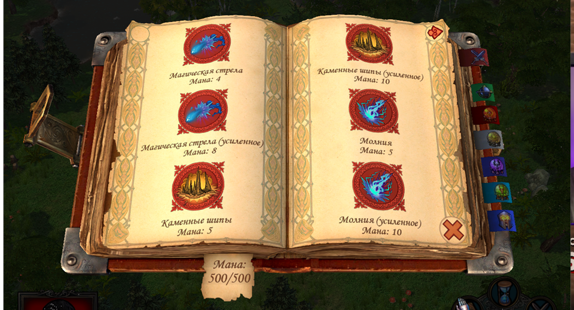
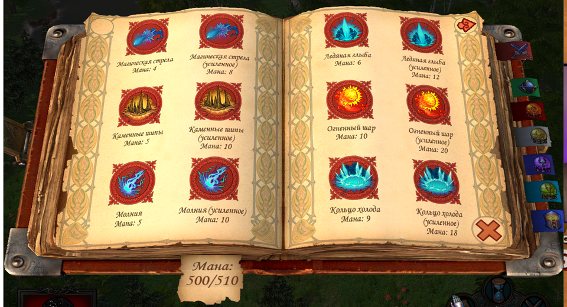
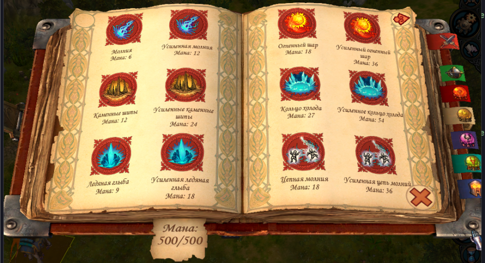

# Heroes V · Spellbook12

**Вдвое больше заклинаний в той же родной 3D-книге.**

Косметический мод для **Universe 2.0.1** и **Heroes 5.5 RC19k** на Windows.
Два столбца и три ряда на каждом листе; родные рисунки, миниатюры и перелистывание.

**Скачать beta.2:**
[Universe](https://github.com/EgorKorotaev/heroes-v-spellbook12/releases/download/v0.1.0-beta.2/Spellbook12-0.1.0-beta.2-Universe.zip) ·
[Heroes 5.5 RC19k](https://github.com/EgorKorotaev/heroes-v-spellbook12/releases/download/v0.1.0-beta.2/Spellbook12-0.1.0-beta.2-H55-RC19k.zip) ·
[Все файлы и описание выпуска](https://github.com/EgorKorotaev/heroes-v-spellbook12/releases/tag/v0.1.0-beta.2)

| Без Spellbook12 · 6 заклинаний | С Spellbook12 · 12 заклинаний |
| :---: | :---: |
|  |  |

Настоящие кадры Universe: один герой, одна тестовая миссия и одинаковый размер
окна. Слева наш ресурсный мод и изменения в памяти полностью отключены.
Нажми на изображение, чтобы рассмотреть его. [О снимках](docs/images/README.md).

## Что меняется

- **12 заклинаний на развороте.** Заполнение по строкам: сначала левый лист,
  затем правый. Меньше перелистываний, привычный порядок заклинаний.
- **Книга шире, русские названия переносятся.** Сохранены родные ресурсы
  миниатюр и шрифта; настроены подсказки, подсветка и области выбора.
- **Исправлено просвечивание при перевороте.** Бумага и движущиеся надписи
  изгибаются согласованно. Родной анимационный клип сохранён.

## Установка

1. Полностью распакуй **player ZIP своей редакции** — `Universe` или `H55-RC19k`.
2. Закрой игру, запусти `Install.cmd` и выбери папку игры с `bin` и `data`.
3. Запускай через **Spellbook12 - Play** в папке игры. Дождись сообщения
   **Spellbook12 is ready** до начала или загрузки карты.

Python игроку не нужен. Для удаления: закрой игру и запусти
`Spellbook12/Uninstall.cmd`. Перед обновлением удали предыдущую установку.

[Подробная инструкция на русском](README.txt) · [English instructions](README.en.txt)

Файл EXE на диске сохраняется: launcher применяет изменения только в памяти
запущенной им игры. **PAK и launcher должны работать вместе.** Обычный запуск
через EXE или H5Lobby не включает runtime-часть; для игры без нашего launcher
сначала удали мод. Перенос одного PAK не является установкой Spellbook12.

## Совместимость

| Игра или режим | Статус |
| --- | --- |
| Universe 2.0.1 · `H5_Game.exe` | Проверена книга, перелистывание и взаимодействия в отдельной копии |
| Heroes 5.5 RC19k · `MMH55_64.exe` | Проверены все 6 боевых разворотов, кнопки, подсказки и каст из позиции 7 |
| Другие EXE, версии, Frax / Ultimate / Utility | Поддержка этим выпуском не заявлена; нужен отдельный проверенный профиль |
| Сетевая игра, LAN, совместимость с сетевыми сборками | **Не тестировались** |
| Запуск через H5Lobby | **Не интегрирован** |
| Все разрешения, языки и сочетания с другими UI-модами | Полная проверка не проводилась |

Поддержку определяют точный SHA-256 EXE и проверка исходных инструкций;
одного совпадения названия версии недостаточно. [Хеши и сборка](docs/BUILD.txt).

Это **бета**. Пройденные проверки и их пределы перечислены в
[VALIDATION.txt](VALIDATION.txt). Свежий полный прогон кампаний и Save/Load
не заявлен. Шильдики показывают состояние этого выпуска, а не результат
непрерывного CI или сертификацию всех сборок.

## Баги и предложения

Нашёл съехавшую подсказку, странный клик или артефакт переворота? Есть идея,
как сделать книгу удобнее? **Такие сообщения помогают развивать мод.**

- На GitHub: **[Issues](https://github.com/EgorKorotaev/heroes-v-spellbook12/issues) → New issue → Ошибка / Bug report** или
  **Предложение / Feature request**. Сначала посмотри, нет ли такого сообщения.
- Если получил архив лично: заполни [FEEDBACK.txt](FEEDBACK.txt) и передай
  тому, от кого получил мод, в том же канале. GitHub-аккаунт для этого не нужен.

Достаточно версии игры и мода, шагов воспроизведения и описания «ожидал / получил».
Для визуального бага полезны размер окна и скриншот или короткое видео.
[Подробности и пример отчёта](CONTRIBUTING.md).

## Присоединяйся

**Contributors welcome.** Код — только один из способов помочь. Нужны проверки
на других разрешениях, аккуратные баг-репорты, переводы документации и идеи.
Новые игровые сборки принимаются после отдельной проверки их EXE и поведения.

[Как внести вклад](CONTRIBUTING.md) · [Сборка](docs/BUILD.txt) ·
[База для AI-разработчика](docs/AI-HANDOFF.txt) · [Восемь ADR](docs/adr/README.md)

## Лицензия и ответственность

Мод предоставляется **«как есть», без гарантий**. В пределах, допускаемых
применимым законом, авторы и правообладатели нашего кода не несут
ответственности за убытки, потерю данных или иные последствия установки
и использования мода. Используешь его на свой риск; перед первой установкой
сохрани резервные копии профиля, сохранений и изменяемой игровой сборки.
Полный текст условий — [MIT License](LICENSE.txt),
[официальный текст MIT](https://opensource.org/license/mit).

MIT относится к нашему оригинальному коду и документации. Игровые ресурсы
имеют собственных правообладателей; их происхождение описано в
[NOTICES.txt](NOTICES.txt). Для установки нужна своя рабочая игра.
Полные игровые архивы, EXE, DLL, тестовые карты и сохранения в исходники
не входят. Неофициальный проект сообщества; поддержки от авторов игры или
глобальных модов этим выпуском не заявляется.

Код и история — в [публичном репозитории](https://github.com/EgorKorotaev/heroes-v-spellbook12).
Архивы установки, исходники и Git bundle — в
[предварительном выпуске beta.2](https://github.com/EgorKorotaev/heroes-v-spellbook12/releases/tag/v0.1.0-beta.2).
Готовые пакеты собраны из тега `v0.1.0-beta.2`; для точного повторения сборки
используй этот тег. Документы в архивах фиксируют состояние на дату сборки;
актуальные ссылки находятся на этой странице.
