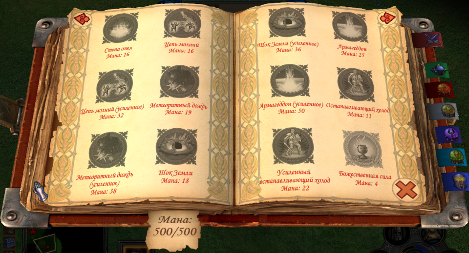

# Heroes V Spellbook12

Родная 3D-книга магии с **12 заклинаниями на развороте**: два столбца и три ряда
на каждом листе. Косметический мод для точных сборок Universe 2.0.1 и Heroes 5.5
RC19k. Игровой EXE на диске сохраняется; необходимые изменения применяются
launcher только к запущенному им процессу.

- [Установка и ограничения — русский](README.txt)
- [Installation — English](README.en.txt)
- [Сборка из собственной игры](docs/BUILD.txt)
- [Передача разработчику или AI](docs/AI-HANDOFF.txt)
- [ADR: решения и полученные шишки](docs/adr/README.md)
- [Результаты проверок этого кандидата](VALIDATION.txt)
- [Снимок проверенной книги в 5.5](docs/images/H55-twelve-spells.png)

Для игрока предназначен ZIP его редакции с `Install.cmd`; Python ему не нужен.
Исходники предназначены для сборки и доработки. Архивы игрока создаются командой
`python build.py --edition universe|h55 --game-root /path/to/game`.

Наш код — [MIT](LICENSE.txt). Происхождение игровых ресурсов и границы лицензии
описаны в [NOTICES.txt](NOTICES.txt). Полные игровые архивы, EXE, DLL, тестовые
карты и пользовательские сохранения в исходники не включены.

Это частный кандидат первой беты. Публичный GitHub-релиз ещё не опубликован.
