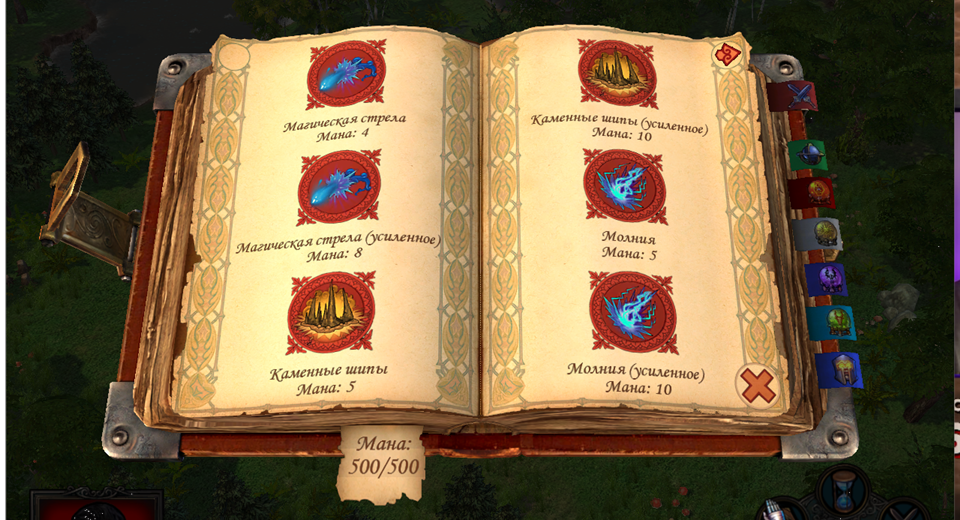
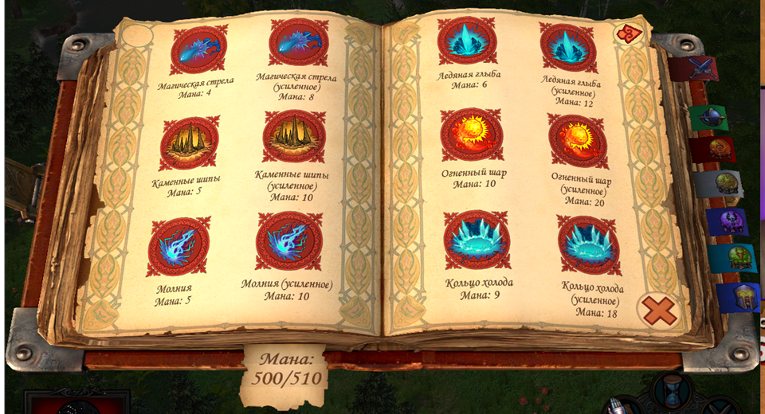

# Spellbook12 · 0.1.0-beta.2

12 заклинаний на развороте родной 3D-книги Heroes V: два столбца и три ряда
на каждом листе. Сохранены рисунки, миниатюры и родное перелистывание;
настроены перенос текста, подсказки и выбор заклинаний.

В beta.2 добавлены сравнение «без / с», оформление README, понятные ограничения,
инструкции для участников и формы обратной связи. Ресурсы и код книги,
launcher и установщик совпадают с проверенной beta.1.

| Без Spellbook12 · 6 заклинаний | С Spellbook12 · 12 заклинаний |
| :---: | :---: |
|  |  |

Настоящие кадры одной тестовой миссии Universe при одинаковом размере окна.

Выбери пакет своей редакции:

- [Universe.zip](https://github.com/EgorKorotaev/heroes-v-spellbook12/releases/download/v0.1.0-beta.2/Spellbook12-0.1.0-beta.2-Universe.zip) — точная проверенная Universe 2.0.1.
- [H55-RC19k.zip](https://github.com/EgorKorotaev/heroes-v-spellbook12/releases/download/v0.1.0-beta.2/Spellbook12-0.1.0-beta.2-H55-RC19k.zip) — точная проверенная 5.5 RC19k,
  `MMH55_64.exe`.
- [Source.zip](https://github.com/EgorKorotaev/heroes-v-spellbook12/releases/download/v0.1.0-beta.2/Spellbook12-0.1.0-beta.2-Source.zip) — код, снимки, инструкции и ADR.
- [Git bundle](https://github.com/EgorKorotaev/heroes-v-spellbook12/releases/download/v0.1.0-beta.2/Spellbook12-0.1.0-beta.2.bundle) — полная история Git на момент beta.2.
- [Handoff.zip](https://github.com/EgorKorotaev/heroes-v-spellbook12/releases/download/v0.1.0-beta.2/Spellbook12-0.1.0-beta.2-Handoff.zip) — полный комплект для игрока и его AI; начни с `START-HERE.txt` внутри.

Контрольные суммы приложенных файлов:
[SHA256SUMS.txt](https://github.com/EgorKorotaev/heroes-v-spellbook12/releases/download/v0.1.0-beta.2/SHA256SUMS.txt).

Полностью распакуй player ZIP, закрой игру и запусти `Install.cmd`.
Запускай через **Spellbook12 - Play**; дождись **Spellbook12 is ready**
до загрузки карты. Python не нужен. Перед обновлением удали предыдущий мод.

**Сетевая игра и сетевые сборки не тестировались; запуск через H5Lobby
не интегрирован.** Другие EXE требуют отдельного проверенного профиля.
Мод предоставляется «как есть», без гарантий, с условиями ответственности
из MIT в пределах применимого закона. Перед установкой сохрани резервные копии.
Игровой EXE на диске не переписывается; PAK и runtime-launcher нужны вместе.

Баги и идеи приветствуются: [GitHub Issues](https://github.com/EgorKorotaev/heroes-v-spellbook12/issues) с готовыми формами либо `FEEDBACK.txt`
из архива для личной передачи. Участвовать можно тестами, переводами,
документацией и кодом. MIT распространяется на наш оригинальный код;
игровые ресурсы имеют собственных правообладателей.

Проверено: 12 тестов без игры, 36 проверок Windows-установки, побайтная
неизменность игровых компонентов относительно beta.1 и воспроизводимая сборка.
Подробные игровые результаты и пределы — в `VALIDATION.txt`.

Архивы собраны из тега `v0.1.0-beta.2` (`7797051`); этот тег сохраняется.
Документы в архивах фиксируют состояние на дату сборки.
[Актуальная страница проекта и инструкции](https://github.com/EgorKorotaev/heroes-v-spellbook12).
